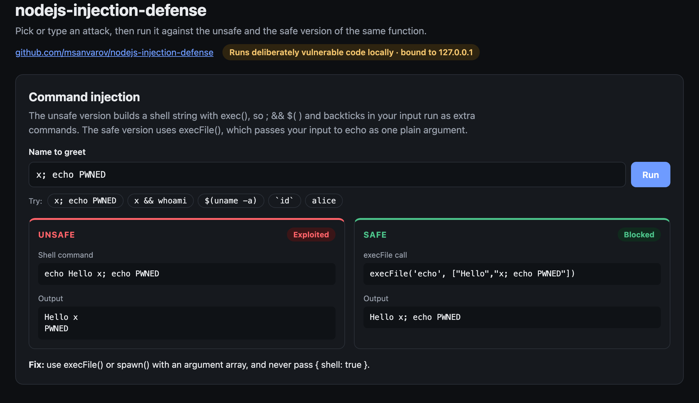
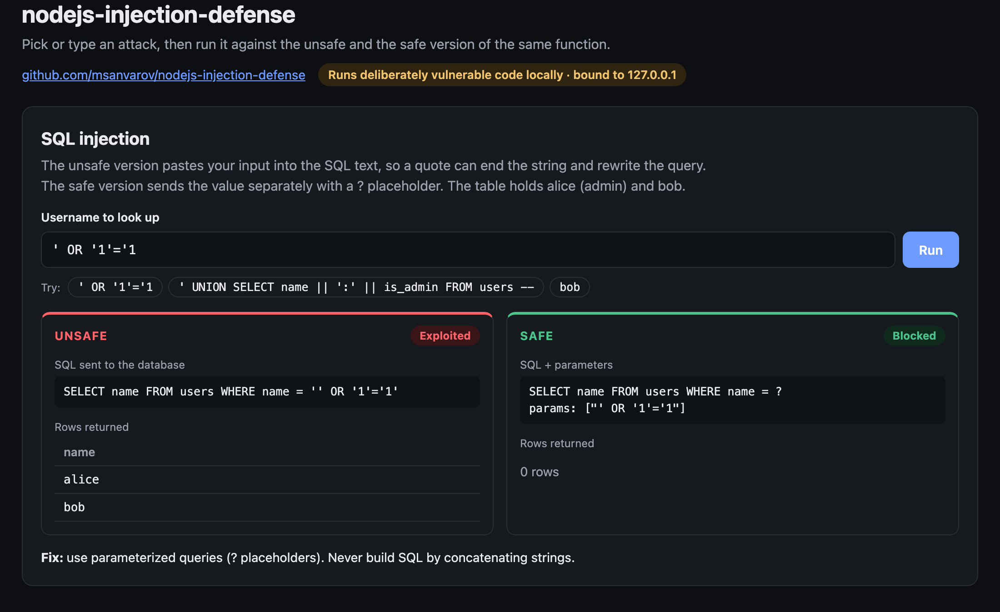
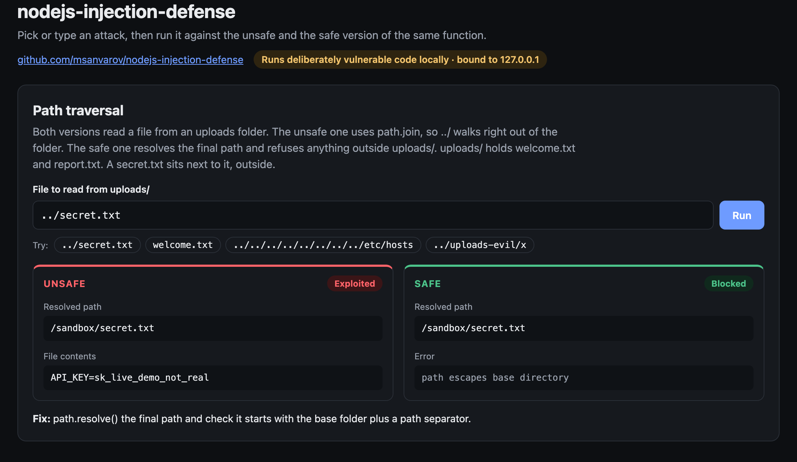
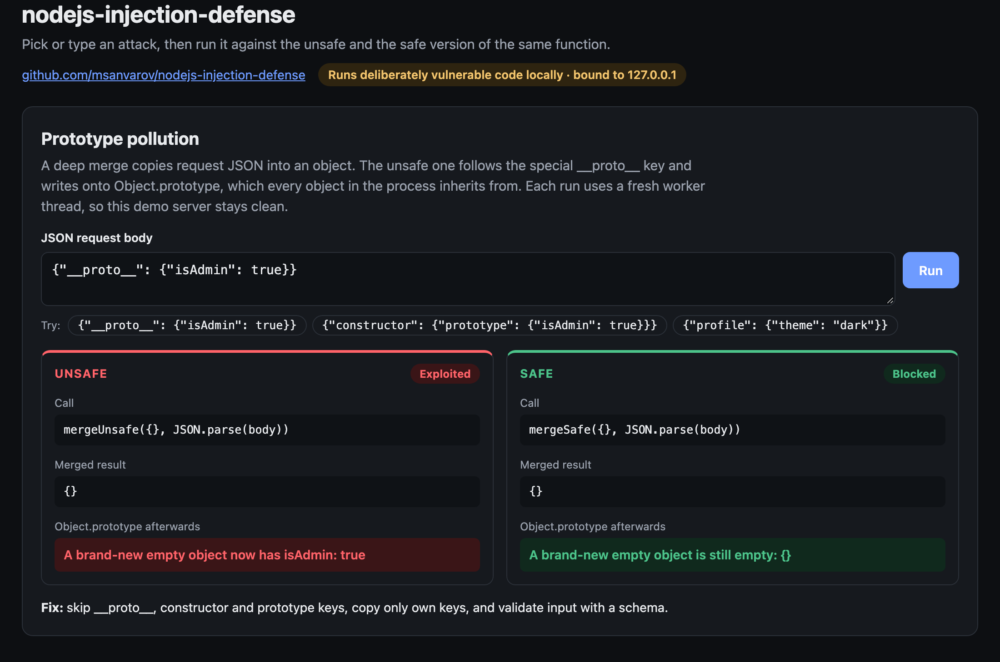
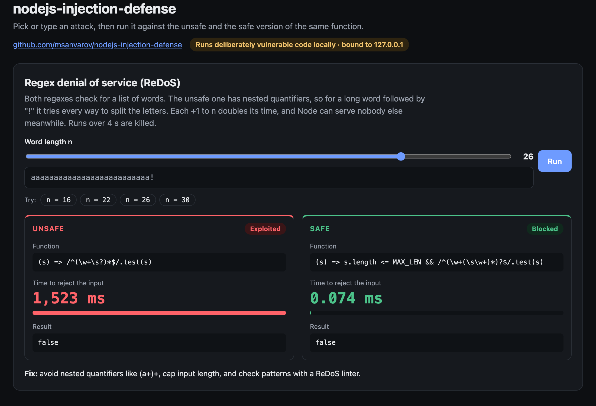

# nodejs-injection-defense

[](https://github.com/msanvarov/nodejs-injection-defense/actions/workflows/test.yml)    [](https://nodejs-injection-defense.netlify.app)

Small, runnable examples of the most common injection bugs in Node.js. Each file in `src/` has an **unsafe** version and a **safe** version, and `test/` proves the attack works on one and fails on the other.

No dependencies. Uses only Node built-ins (`node:sqlite`, `node:child_process`, `node:test`).

```bash
npm test
```

## Interactive demo

**Live preview: [nodejs-injection-defense.netlify.app](https://nodejs-injection-defense.netlify.app)**. It replays recorded runs, so nothing executes on that server. Run it locally to try your own payloads.

A local web page that runs each attack against the unsafe and safe version of the same function, side by side.

```bash
npm run demo     # http://127.0.0.1:4101
```

It only listens on `127.0.0.1` and rejects requests from other sites, because it really executes the vulnerable code. Stop it with Ctrl+C when you're done.

The hosted preview is a static build of `demo/recordings.json` (`npm run build`). Refresh the recordings with `npm run demo:record` (needs Google Chrome).

### Command injection

`exec()` runs the extra `echo PWNED` hidden in the name. `execFile()` prints the input as plain text.



### SQL injection

A quote in the username rewrites the concatenated query and returns every user. The placeholder version returns nothing.



### Path traversal

`../secret.txt` walks out of the uploads folder with `path.join`. The resolve-and-check version refuses it.



### Prototype pollution

The naive merge writes `isAdmin` onto `Object.prototype`, so every new object inherits it. Each merge runs in its own worker thread, so the demo server is never polluted.



### ReDoS

A slider sets the word length. The nested-quantifier regex takes over a second at n = 26 and doubles with every extra letter. The safe regex stays well under a millisecond.



> [!WARNING]
> Functions ending in `Unsafe` are **intentionally vulnerable** so the tests can show the attack working. Copy the safe versions, never those.

## Project layout

```text
src/
  command.js     exec() vs execFile()
  sql.js         string concatenation vs placeholders (node:sqlite)
  path.js        path.join vs resolve-and-check
  prototype.js   naive deep merge vs key-filtered merge
  regex.js       catastrophic-backtracking regex vs linear one
test/
  injection.test.js   one test per attack, run against both versions
  demo.test.js        demo API and its local-only guards
demo/
  server.js      local demo server (127.0.0.1 only) calling the src/ functions
  index.html     the demo page, no build step or dependencies
docs/            screenshots used in this README
```

## What's covered

| Bug | File | Attack | Fix |
| --- | --- | --- | --- |
| Command injection | [src/command.js](src/command.js) | `x; rm -rf ~` passed to `exec()` | `execFile()` / `spawn()` with an args array, no shell |
| SQL injection | [src/sql.js](src/sql.js) | `' OR '1'='1` in a concatenated query | Parameterized queries (`?` placeholders) |
| Path traversal | [src/path.js](src/path.js) | `../secret.txt` or `/etc/passwd` | `path.resolve` + check the result stays inside the base dir |
| Prototype pollution | [src/prototype.js](src/prototype.js) | `{"__proto__": {"isAdmin": true}}` | Skip `__proto__`/`constructor`/`prototype`, only own keys |
| ReDoS | [src/regex.js](src/regex.js) | `'a'.repeat(30) + '!'` against `/^(\w+\s?)*$/` | Unambiguous regex + input length cap |

## Mitigations in more detail

### Command injection
- Prefer `execFile` / `spawn` with an argument array. Never build a shell string from input.
- `{ shell: true }` turns `spawn`/`execFile` back into a shell. Avoid it.
- On Windows, running `.bat`/`.cmd` files always goes through `cmd.exe` (see CVE-2024-27980). Keep Node patched.
- Even without a shell, an attacker controlling arguments can pass flags (`--output=/etc/...`). Put `--` before user values when the program supports it, and allowlist values when you can.

### SQL / NoSQL injection
- Always use placeholders. ORMs are safe until you reach for `raw()` / `$queryRawUnsafe`.
- NoSQL has its own version: `{ "password": { "$ne": null } }` in a MongoDB query. Validate that fields are the type you expect (string, not object) before they reach the query.

### Path traversal
- `path.join` and `path.normalize` do **not** protect you.
- Check `target.startsWith(root + path.sep)`, not just `startsWith(root)`, or `/uploads-evil` passes a check for `/uploads`.
- Don't use user input as a filename at all when you can avoid it. Store files under a generated ID and keep the original name in a database.
- If the directory may contain symlinks, `fs.realpath` the result before checking.

### Prototype pollution
- Validate request bodies against a schema (e.g. Zod, Ajv with `additionalProperties: false`) so unexpected keys never reach merge code.
- Use `Map` or `Object.create(null)` for dictionaries keyed by user input.
- Defense in depth: run Node with `--disable-proto=delete`, or `Object.freeze(Object.prototype)` at startup.
- Keep merge/clone libraries (lodash, etc.) updated. Many had CVEs for exactly this.

### ReDoS (regex denial of service)
- Node is single threaded. One slow regex blocks every request.
- Avoid nested quantifiers like `(a+)+`, `(\w+\s?)*`, `(.*,)*`.
- Cap input length before matching.
- Check patterns with a tool such as [recheck](https://makenowjust-labs.github.io/recheck/) or the `eslint-plugin-regexp` / `eslint-plugin-security` rules.

Try it yourself (this will hang for several seconds):

```bash
node -e "console.time('t'); /^(\w+\s?)*$/.test('a'.repeat(28) + '!'); console.timeEnd('t')"
```

### `eval`, `new Function`, `vm`
- Never `eval` input. Parse JSON with `JSON.parse`.
- `node:vm` is **not** a security boundary. Its docs say so. Code inside a `vm` context can escape to the host. For untrusted code, use a separate process with the permission model (see `nodejs-supply-chain-security`), a container, or an isolate library built for it.

## Node.js security series

| Repo | Covers |
| --- | --- |
| **nodejs-injection-defense** (you are here) | Command, SQL, path traversal, prototype pollution, ReDoS |
| [nodejs-http-hardening](https://github.com/msanvarov/nodejs-http-hardening) | Headers, body limits, timeouts, rate limiting, CORS, safe errors |
| [nodejs-supply-chain-security](https://github.com/msanvarov/nodejs-supply-chain-security) | npm config, CI auditing, install-script scanning, permission model |
| [nodejs-crypto-secrets](https://github.com/msanvarov/nodejs-crypto-secrets) | Password hashing, tokens, JWTs, encryption, secrets |

## Running it

Requires Node.js 22.13 or newer. No `npm install` needed.

```bash
git clone https://github.com/msanvarov/nodejs-injection-defense.git
cd nodejs-injection-defense
npm test
```

Found a mistake or want to add an example? Issues and pull requests are welcome.

## License

[MIT](LICENSE)
